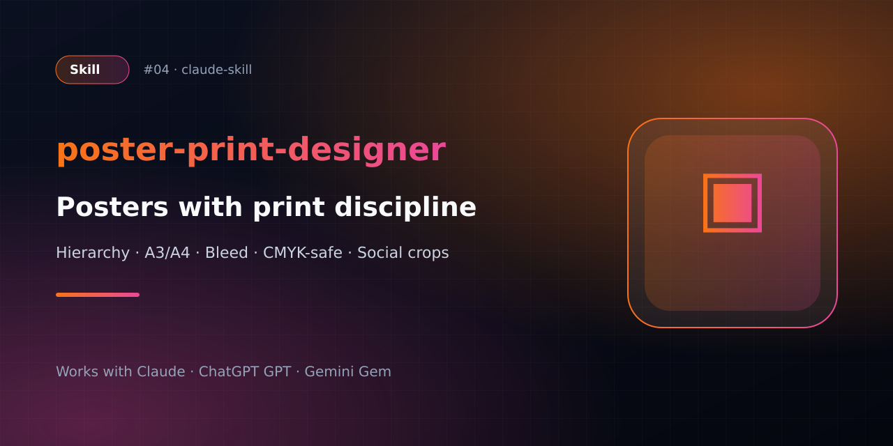

<p align="center"><a href="https://cloudskillhub.com"></a></p>

# poster-print-designer

🌐 **Website:** [cloudskillhub.com](https://cloudskillhub.com) · 📦 **All skills:** [skillhub](https://github.com/jahirulofficial0/skillhub)

Poster design skill with real print discipline — headline hierarchy, layout spec, A3/A4 print-ready specs with bleed and CMYK-safe colours, plus matching social crops.

**Works with:** Claude (Code, Desktop, claude.ai) · ChatGPT custom GPT · Gemini Gem

## Install

### Claude Code — this skill only
```
/plugin marketplace add jahirulofficial0/skillhub
/plugin install poster-print-designer@skillhub
```
Or directly from this repo: copy `skills/poster-print-designer/` into `~/.claude/skills/`.

### All 10 skills at once
See **[skillhub](https://github.com/jahirulofficial0/skillhub)** — one marketplace, or one MCP server that serves all 10 skills.

### claude.ai
Download `skills/poster-print-designer/` as a ZIP → **Settings → Capabilities → Skills → Upload skill**.

### ChatGPT / Gemini
- ChatGPT GPT: [`prompts/chatgpt-gpt.md`](prompts/chatgpt-gpt.md)
- Gemini Gem: [`prompts/gemini-gem.md`](prompts/gemini-gem.md)

## Usage
Just describe the task — the skill activates when relevant. Example:

> Poster for a CCTV installation offer, A3, headline 'Secure Your Shop 24/7', 20% off till 31 Dec, phone + QR, brand colour #0EA5E9.

See [`examples/`](examples/) for a full input → output sample.

## What you get
```
## Hierarchy
| Level | Content | Size (pt) |

## Layout Spec (A4/A3, mm)
Grid: … | Zones: …

## Type & Colour
| Role | Font | Size | Colour HEX | CMYK |

## Print-Ready Checklist
- [ ] Document size with 3 mm bleed: …
- [ ] Safe zone 5 mm
- [ ] 300 DPI images, CMYK, PDF/X

## Social Crops
| Format | Size | Changes |
```

## Repository layout
```
.claude-plugin/plugin.json   Claude Code plugin manifest
skills/poster-print-designer/SKILL.md       The skill
prompts/                     ChatGPT GPT and Gemini Gem versions
examples/                    Sample input and output
assets/banner.png            Social preview image
```

## Author
**Jahirul** — [cloudskillhub.com](https://cloudskillhub.com) · [github.com/jahirulofficial0](https://github.com/jahirulofficial0)

## License
MIT — see [LICENSE](LICENSE).
